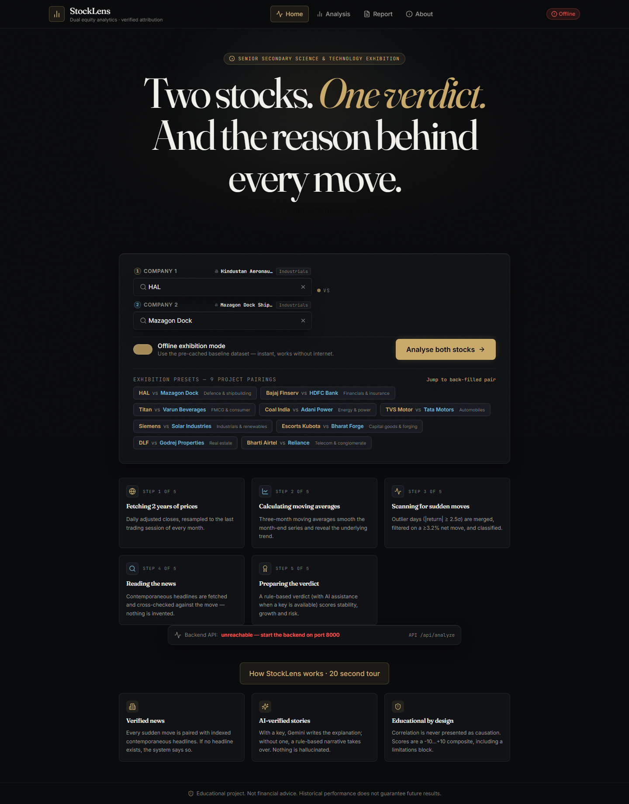
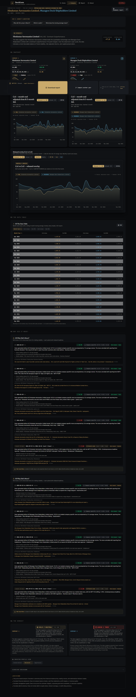

# StockLens

StockLens compares two listed companies using adjusted price history, transparent calculations, detected price moves, source-linked news context, and a rule-based recommendation summary. It is an educational exhibition project, not investment advice.

## Screenshots





## Features

- Compare the nine exhibition pairs or resolve another listed company by name or ticker.
- View daily and month-end adjusted prices, a rolling three-month average, normalized performance, volatility, drawdown, correlation, beta, and return metrics.
- Detect statistically unusual moves and show linked news/source context when available. Explanations distinguish observed evidence from possible context; they do not establish causation.
- Inspect a weighted, rule-based Buy/Hold/Avoid summary and the signals behind it.
- Export analysis reports and data tables; scan the configurable Home-page QR code to open the project or report URL.
- Run with live data or use clearly labelled, pre-fetched offline snapshots for all nine project pairs. Ctrl+Shift+D toggles demo mode; P starts presenter mode; `?kiosk=1` enables kiosk layout.
- Use the five-step “How it works” explainer and judge-question shortcuts during an exhibition.

## How the maths works

The backend calculates from Yahoo Finance adjusted closes. Dates with unusable prices are excluded; reported values therefore depend on the available history and its quality.

- **Cumulative return:** `(last adjusted close / first adjusted close - 1) × 100`.
- **CAGR:** `(last / first)^(365.25 / elapsed calendar days) - 1`, expressed as a percentage.
- **Annualized volatility:** sample standard deviation (`ddof=1`) of daily percentage returns multiplied by `√252`, expressed as a percentage.
- **Maximum drawdown:** largest percentage fall from a prior running peak to a later trough.
- **Sharpe-style ratio:** `(CAGR − configured risk-free rate) / annualized volatility`. This is a simplified annual-metric ratio, not a calculation from daily excess returns.
- **Three-month moving average:** arithmetic mean of the latest three month-end adjusted closes. The first two months have no three-month value.
- **Beta and correlation:** estimated from overlapping daily returns against the configured benchmark/pair series. They describe historical co-movement, not future exposure or protection.
- **Anomaly detection:** screens historical price/return changes against the project's statistical thresholds. Nearby news may provide context, but matching a date does not prove that a headline caused a move.
- **Recommendation summary:** six rule-based signals (trend, momentum, risk, return quality, 52-week distance, and valuation proxy) are combined with configured weights and mapped to Buy, Hold, or Avoid thresholds. It is not a forecast and omits company financial statements, governance, investor circumstances, taxes, and transaction costs.

All metrics are historical, sensitive to the selected window and data source, and may be wrong or incomplete. “Risk” is broader than volatility: volatility measures dispersion of returns, while risk can include permanent loss, liquidity, concentration, business, and model/data risk.

## Run locally

Requirements: Python 3.11+ and Node.js 20+.

```powershell
Copy-Item backend/.env.example backend/.env
python -m pip install -r backend/requirements.txt
cd frontend
npm ci
cd ..
```

Set optional `GEMINI_API_KEY` in `backend/.env` if you want the hosted language-model narrative. The deterministic explanation path works without it. Do not put secrets in `frontend/.env` or any `VITE_*` variable: frontend variables are public in the browser bundle.

Run the API and UI in separate terminals:

```powershell
cd backend
python -m uvicorn app.main:app --host 127.0.0.1 --port 8000
```

```powershell
cd frontend
npm run dev -- --host 127.0.0.1 --port 5173
```

For an exhibition without a working network, use the shipped snapshots. To refresh them from live data, run `python scripts/build_demo_snapshots.py`. Warm the price cache before a live-data demo with `python scripts/warm_cache.py`. Check readiness with `python scripts/preflight.py`. See [Exhibition checklist](docs/EXHIBITION_CHECKLIST.md), [spoken demo script](docs/DEMO_SCRIPT.md), and [judge Q&A](docs/JUDGE_QA.md).

## Configuration and security

Backend settings are documented in [backend/.env.example](backend/.env.example); frontend settings are in [frontend/.env.example](frontend/.env.example). CORS defaults to the two local development origins and accepts explicit HTTP(S) origins only. Configure the production origin explicitly. `/api/analyze` has a per-process, per-client sliding-window rate limit (`ANALYZE_RATE_LIMIT_PER_MINUTE`, default 60/minute); deployments with multiple workers should enforce a shared edge or Redis limit as well.

## Credits

- **Built for StockLens:** the pairing and exhibition UI, analysis orchestration, analytics and anomaly rules, recommendation scoring, offline snapshot/fallback flow, report assembly, and presentation modes.
- **Libraries:** React, TypeScript, Vite, Tailwind CSS, Recharts, Lucide, qrcode.react; FastAPI, Pydantic, Pandas, NumPy, yfinance, RapidFuzz, Feedparser, PyMuPDF, and Matplotlib. These provide UI primitives, charting, HTTP/data handling, or document utilities; they do not make investment decisions for StockLens.
- **Data and context:** Yahoo Finance via yfinance for historical market data; Google News RSS and linked publishers for news context; Google Gemini is an optional narrative service when configured. Availability, licensing, coverage, and data accuracy are controlled by those providers.

## Disclaimer

StockLens is for learning and demonstration. It is not financial, legal, or tax advice, and its labels are not a recommendation to trade. Verify source data independently and consult a qualified professional before making financial decisions.
